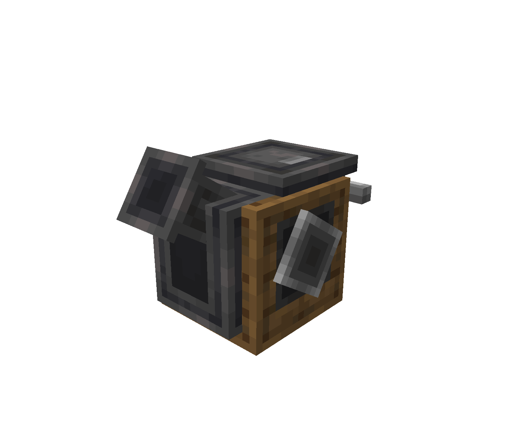
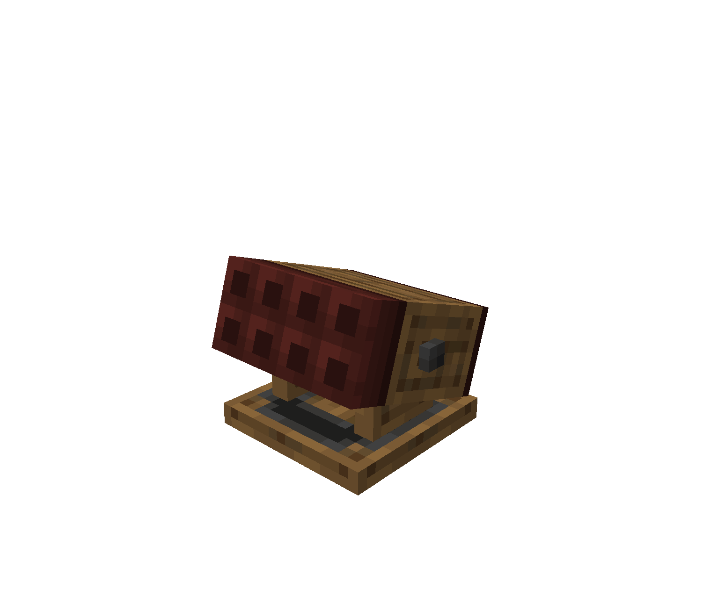
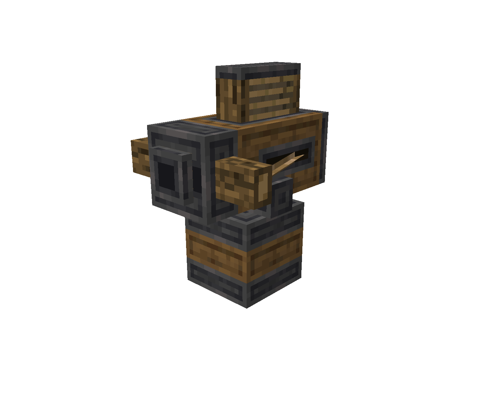

<p align="center">
  
</p>

<p align="center">
  <b>Siege warfare, block by block.</b><br>
  A NeoForge and Fabric mod that adds cannons, spewers, volley racks and iron crossbow golems to Minecraft.
</p>

<p align="center">
  
  
  
</p>

---

## About

Vanilla Minecraft has TNT and a crossbow, and not much in between. **Blocky Siege** fills the gap with weapons you build, load and crew: a cannon that hurls any block, a burst cannon that sprays any item, a spewer that blasts any liquid, a rack that launches whole volleys, and crossbow golems that guard your walls the way iron golems guard villages.

Pillagers, Vindicators and Piglins can man siege weapons too, so your own fortress is no longer safe. Everything works on moving ships with **Sable** and **Create Aeronautics**.

## Features

> 📸 **[SCREENSHOT PLACEHOLDER: hero shot of a castle wall with a cannon, volley rack and crossbow golem]**

All siege weapons are placed as blocks. Right-click one to open its menu and load it, then climb in and aim. **Hold the fire key (right-click) to keep firing** from the spewer and the volley rack.

### 💣 Cannon


Shoots **any block**. Load it with cannonballs, bombs or anything else you can place, set the power, aim and fire.

- Cannonballs skim, bounce, roll and come to rest instead of sticking into the ground.
- They hit hard enough to break through walls. Landed cannonballs break instantly in creative mode.
- Get hit and the game tells everyone, with eight different cannonball death messages.

<br clear="right">

### 🎆 Burst Cannon


Shoots **any item**, several at a time. Set the burst count in its menu.

- Fire it with **firework stars** and the bullets follow the star's explosion effects, so a volley can double as a fireworks display.
- Its projectiles fly further than the other weapons'.

<br clear="right">

### 🌊 Spewer



Shoots **any liquid**, including modded fluids. Fill its tank with buckets and use the drain slot to empty it again. Water, lava and more become a stream you can aim, and holding the fire key keeps it flowing.

<br clear="right">

### 🚀 Volley Rack



Shoots a **volley of projectiles** at once. Load it with fireworks and arrows, then hold the fire key to keep the volley coming.

<br clear="right">

### 🏹 Crossbow Golem



A sentry for your walls, built **just like an iron golem**: an iron block base, a dispenser on top and a log. You can also craft it as a block and place it, or use its spawn egg from the Spawn Eggs tab.

- Right-click it to open its menu. It holds a crossbow and fires **arrows and fireworks**, with a muzzle ring animation when it shoots.
- **Team support.** It joins **your scoreboard team** when you place it and spares its teammates. The menu shows the team icon.
- **Iron ingot repair.** Right-click it with an iron ingot to heal 25 HP. It shows cracks as it takes damage.
- **Fletcher restocking.** Like an iron golem it counts as player-made, and **fletcher villagers restock its arrows** each morning.
- **Mending.** A crossbow with Mending never loses durability when the golem fires it.
- It shoots mobs far below it, so a tower is a great post.
- Advancement: *Iron Sentry*. Build a crossbow golem.

<br clear="right">

### 🧨 Ammo

| Ammo | What it does |
| --- | --- |
| **Cannonball** | The classic solid shot. Smashes through blocks and mobs. |
| **Spectral Cannonball** | Punches through multiple blocks. |
| **Fire Bomb** | Sets the target area ablaze and leaves embers that glow with dynamic lights. |
| **Frost Bomb** | Freezes the impact zone and leaves frost piles. |
| **Wind Bomb** | Blasts mobs and blocks outward with a gust. |
| **Explosive Keg** | Flies as a primed barrel that blinks like TNT. |
| **Any block / item / liquid** | Fire anything from the cannon, burst cannon and spewer. |

Placed ammo can be picked back up: **right-click** a stack of cannonballs or bombs to take one piece.

> 📸 **[SCREENSHOT PLACEHOLDER: ammo lineup, bombs impacting]**

### 🏴 Siege crews

- **Pillagers, Vindicators and Piglins** man nearby cannons, burst cannons and spewers and use them on you.
- Turn the whole thing off with the `doSiegeWeaponCrews` game rule, or tune it in the config.

### 🧑‍🔧 Siege Engineer

A new villager profession that sells gunpowder, explosive barrels, cannonballs, cannons, burst cannons, volley racks and spewers for emeralds as they level up.

### 🚩 Banner patterns

**Boom** and **Fort** banner patterns to fly over your fortress.

## Requirements

| | Version |
|---|---|
| Minecraft | 1.21.1 |
| NeoForge | 21.1.139 or newer |
| Fabric | Loader 0.16.14 or newer, with Fabric API |

Install it like any other mod: drop the jar into your `mods` folder. It is needed on both the client and the server.

**Optional** (none are needed, they just add extras):

| Mod | What it adds |
|---|---|
| [Sable](https://modrinth.com/mod/sable) and [Create Aeronautics](https://modrinth.com/mod/create-aeronautics) | Siege weapons and crossbow golems work on moving ships. |
| [LambDynamicLights](https://modrinth.com/mod/lambdynamiclights) | Fire bombs and embers light up their surroundings. |

## Configuration

Settings live in `config/blockysiege-common.toml` and client-only settings in `config/blockysiege-client.toml` (Fabric uses `.properties` files with the same names).

<details>
<summary><b>common</b></summary>

| Option | Default | What it does |
|---|---|---|
| `cannonDamage` | `25` | How much damage cannons deal. |
| `crewsBringAmmo` | `true` | Whether crews reload empty weapons with their own ammo, or only use ones already loaded. |
| `crewSearchRadius` | `16` | How far, in blocks, a crew mob with a target looks for a weapon to man (4 to 48). |

</details>

<details>
<summary><b>client</b></summary>

| Option | Default | What it does |
|---|---|---|
| `cannonVolume` | `1.0` | Volume of cannon sounds, from `0.0` to `1.0`. |

</details>

## Compatibility

- **Sable and Create Aeronautics:** the crossbow golem rides along on moving sub-levels, targets and shoots from them, you can crew siege weapons on them, and cannonballs hit and break blocks on ships.
- **LambDynamicLights:** fire bombs and embers ship with dynamic light data for mods that read the standard format.
- **Modded fluids:** work in the spewer.
- **Translations:** English, Russian, Ukrainian, Spanish (Spain) and Spanish (Mexico).

> 📸 **[SCREENSHOT PLACEHOLDER: cannon firing from a Create Aeronautics ship]**

## Building from source

```bash
git clone https://github.com/LuckyOwlStudios/blocky-siege.git
cd blocky-siege
./gradlew build                 # jars end up in neoforge/build/libs and fabric/build/libs
./gradlew :neoforge:runClient   # or :fabric:runClient
./gradlew :neoforge:runData     # regenerate assets and data into common/src/generated
```

Java 21 is required. The project is a multiloader build based on [MultiLoader-Template](https://github.com/jaredlll08/MultiLoader-Template): `common/` holds almost all of the mod, `neoforge/` and `fabric/` hold the loader entry points.

## Credits

- Made by **LuckyOwl** ([LuckyOwlStudios](https://github.com/LuckyOwlStudios))

Found a bug or have an idea? [Open an issue](https://github.com/LuckyOwlStudios/blocky-siege/issues). See the [changelog](https://github.com/LuckyOwlStudios/blocky-siege/blob/master/CHANGELOG.md) for what's new.

## License

Blocky Siege is **All Rights Reserved**. The original template files are covered by the MIT license in [`TEMPLATE_LICENSE.txt`](TEMPLATE_LICENSE.txt).
