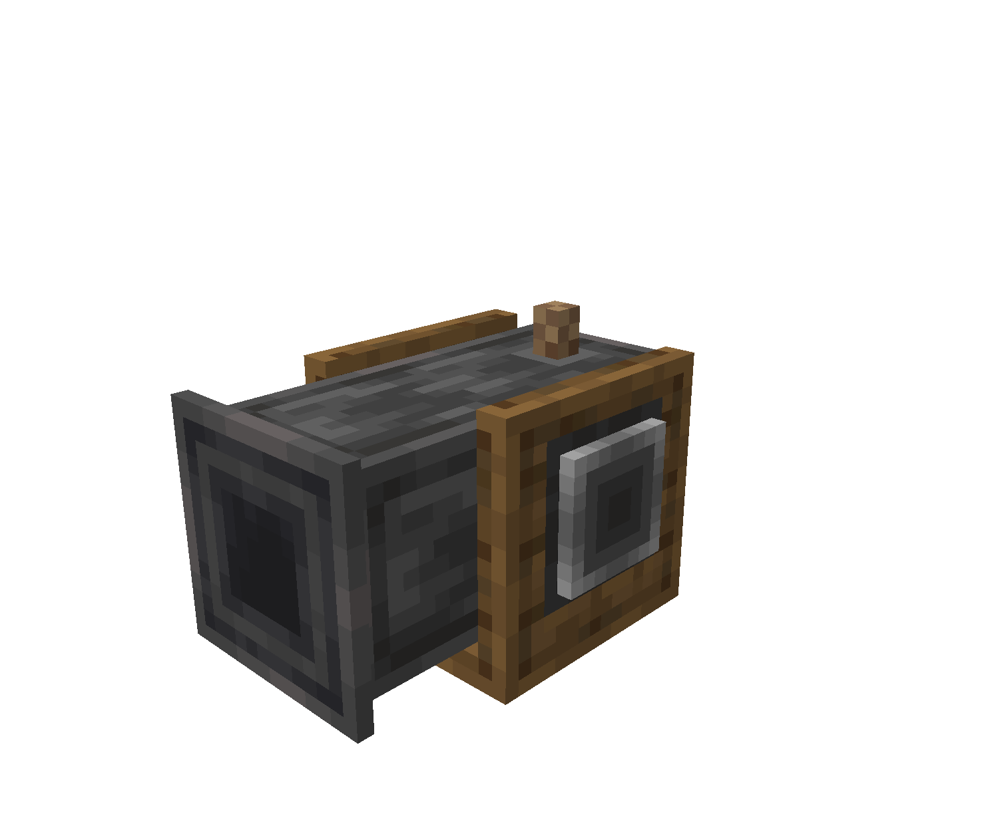
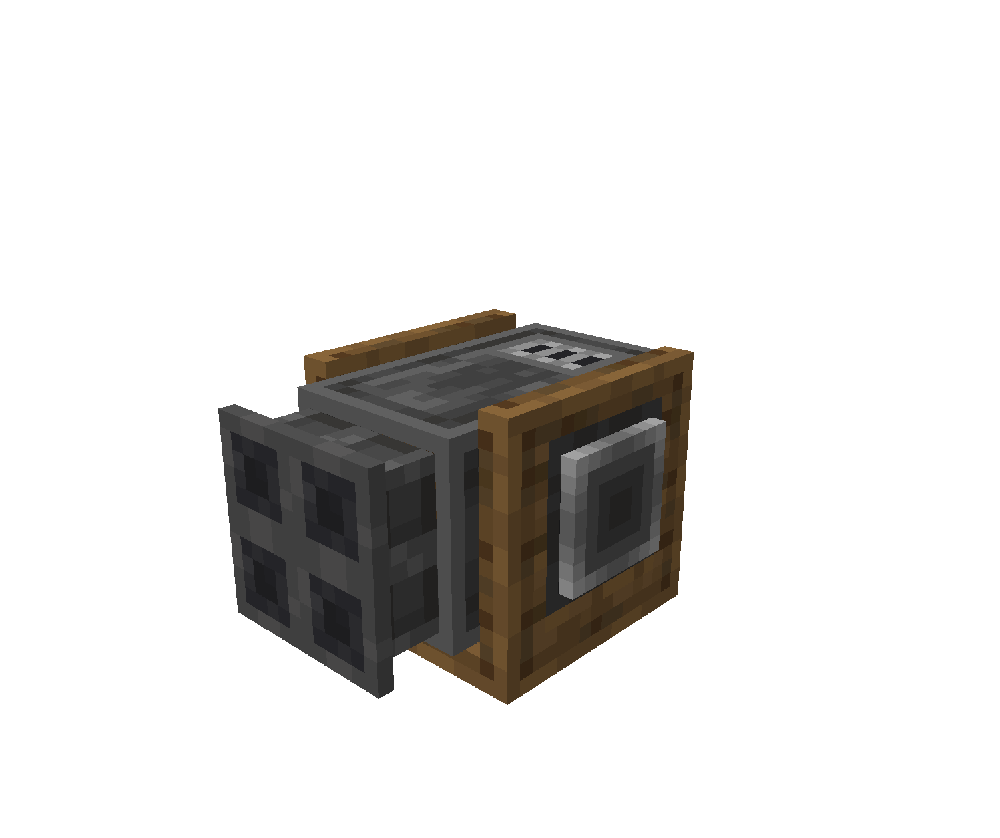

<p align="center">
  
</p>

<p align="center">
  <b>Siege warfare, block by block.</b><br>
  A NeoForge and Fabric mod that adds cannons, spewers, volley racks and iron crossbow golems to Minecraft.
</p>

<p align="center">
  
  
  
</p>

---

## About

Bring real siege warfare to Minecraft. Build cannons that hurl any block, burst cannons that spray any item, spewers that blast any liquid, volley racks that launch fireworks and arrows, and iron crossbow golems that guard your walls. Man them yourself, or watch Pillagers and Piglins turn them on your base.

> 📸 **[SCREENSHOT PLACEHOLDER: hero shot of a castle wall with a cannon, volley rack and crossbow golem]**

---

## Siege weapons

All weapons are placed as blocks. Right-click one to open its menu, load it, set it up, then climb in and aim. **Hold right-click (the fire key) to keep firing** from the spewer and the volley rack.

### Cannon
Shoots **any block**. Load it with cannonballs, bombs or anything else you can place, set the power, aim and fire. Cannonballs skim, bounce, roll and finally come to rest instead of sticking into the ground, and they hit hard enough to break through walls.



### Burst Cannon
Shoots **any item**, several at a time. Set the burst count in its menu. Fire it with firework stars and the bullets follow the star's explosion effects, so a volley can double as a fireworks display.



### Spewer
Shoots **any liquid**, including modded fluids, from a tank you fill with buckets. It has a drain slot to empty it again. Water, lava and more become a stream you can aim and hold down.


### Volley Rack
Shoots a **volley of projectiles** at once. Hold the fire key to keep the volley coming.


### Crossbow Golem
A sentry for your walls, built **just like an iron golem**: an iron block base, a dispenser on top and a log. There is no crafting recipe, so building the structure is the only way to get one in survival. It also has a spawn egg in the Spawn Eggs tab.

- **Crossbow and ammo menu.** Right-click to open its menu. It holds a crossbow and fires **arrows and fireworks**, with a muzzle ring animation when it shoots. Its ammo box on the model empties as it runs low.
- **Team support.** It joins **your scoreboard team** when you place it and spares its teammates. The menu shows the team icon.
- **Repair with iron.** Right-click it with an **iron ingot** to heal 25 HP, just like an iron golem. It shows cracks as it takes damage.
- **Fletcher restocking.** Like an iron golem it is flagged as player-made, and **fletcher villagers restock its arrows** each morning.
- **Mending.** A crossbow with **Mending** does not lose durability when the golem fires it.
- **High ground.** It will shoot mobs far below it, so it is happy up on a tower.
- Earn the advancement **Iron Sentry** for building one.


---

## Ammo

| Ammo | What it does |
| --- | --- |
| **Cannonball** | The classic solid shot. Smashes through blocks and mobs. |
| **Spectral Cannonball** | Punches through multiple blocks. |
| **Fire Bomb** | Sets the target area ablaze and leaves embers. Glows with dynamic lights. |
| **Frost Bomb** | Freezes the impact zone and leaves frost piles. |
| **Wind Bomb** | Blasts mobs and blocks outward with a gust. |
| **Explosive Keg / Barrel** | Fly as a primed barrel that blinks like TNT. |
| **Any block** | Fire it from the cannon. |
| **Any item** | Fire it from the burst cannon. |
| **Any liquid** | Fire it from the spewer. |

Placed ammo can be taken back: **right-click** a stacked cannonball, spectral, fire, frost or wind bomb pile to pick up one piece.

> 📸 **[SCREENSHOT PLACEHOLDER: ammo lineup, bombs impacting]**

---

## Mobs and villagers

- **Siege crews.** Pillagers, Vindicators and Piglins man nearby cannons, burst cannons and spewers and use them against you. Turn it off with the `doSiegeWeaponCrews` game rule. A config option controls how far they search for weapons and whether they bring their own ammo.
- **Siege Engineer.** A new villager profession that sells gunpowder, explosive barrels, cannonballs, cannons, burst cannons, volley racks and spewers for emeralds as they level up.
- **Banner patterns.** Boom and Fort patterns to fly over your fortress.

---

## Compatibility

- **Sable and Create Aeronautics.** Siege weapons work on moving ships. Crossbow golems ride along, aim and shoot from sub-levels, you can crew weapons on them, and cannonballs hit and break blocks on ships too.
- **LambDynamicLights.** Fire bombs and embers light up their surroundings (works with dynamic-light mods that read the standard datapack format).
- **Modded fluids** work in the spewer.

> 📸 **[SCREENSHOT PLACEHOLDER: cannon firing from a Create Aeronautics ship]**

---

## Details

- **Cannonball death messages.** Eight different messages, with a version that names the shooter: *"Steve was flattened by Alex's cannonball"*, *"Steve took a cannonball to the chest courtesy of Alex"* and more.
- **Config.** Cannon damage, crew search radius, crews bringing their own ammo and cannon volume are configurable.
  - NeoForge: `config/blockysiege-common.toml` and `config/blockysiege-client.toml`
  - Fabric: `config/blockysiege-common.properties` and `config/blockysiege-client.properties`
- **Translations.** English, Russian, Ukrainian, Spanish (Spain) and Spanish (Mexico). More are welcome.
- **Creative tab.** Everything is under **Siege Weapons**.

---

## Building from source

This is a multiloader project based on [MultiLoader-Template](https://github.com/jaredlll08/MultiLoader-Template): `common/` holds almost all of the mod, `neoforge/` and `fabric/` hold the loader entry points.

```
./gradlew build
```

Jars end up in `fabric/build/libs/` and `neoforge/build/libs/`. Run with `./gradlew :neoforge:runClient` or `./gradlew :fabric:runClient`. Data generators run on NeoForge (`./gradlew :neoforge:runData`) and write into `common/src/generated/resources`.

## Links

- [Report a bug or suggest something](https://github.com/LuckyOwlStudios/blocky-siege/issues)
- [Changelog](https://github.com/LuckyOwlStudios/blocky-siege/blob/master/CHANGELOG.md)
